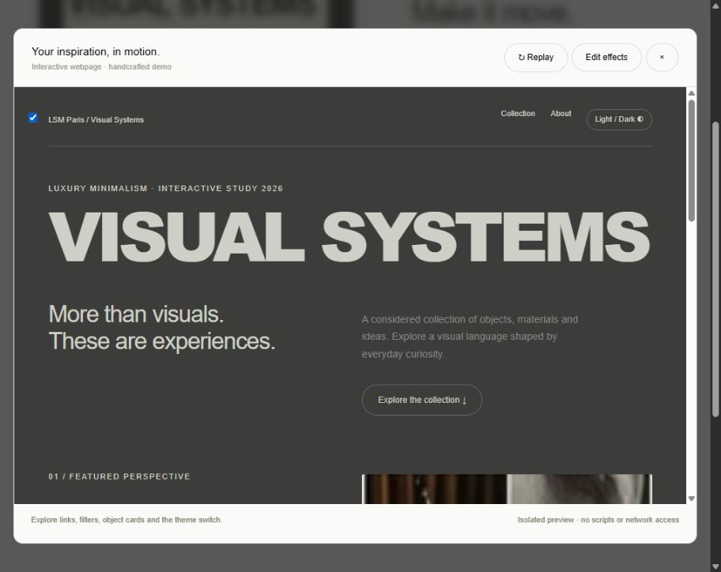

# Cosmos Try It

A local internship-pitch prototype using the exact saved Visual Systems reference.

```powershell
cd comos-try-it-feature
python -m http.server 4173 --bind 127.0.0.1
```

Open http://127.0.0.1:4173 and click **Try It**. Stop with Ctrl+C.

Detection is simulated; generation builds a real interactive HTML/CSS concept page with navigation, filters, expandable cards and a theme switch. No API calls or spending. The preview uses an empty iframe sandbox and restrictive CSP. Downloaded production scripts are never loaded by the prototype.

See [IMPLEMENTATION_PLAN.md](IMPLEMENTATION_PLAN.md) for scope, real-model architecture, milestones and validation criteria.

## Preview



The reference image belongs to its original creator and is included for this concept demonstration. This is an independent internship pitch, not an official Cosmos feature. The downloaded Cosmos page and production scripts are excluded from this repository.